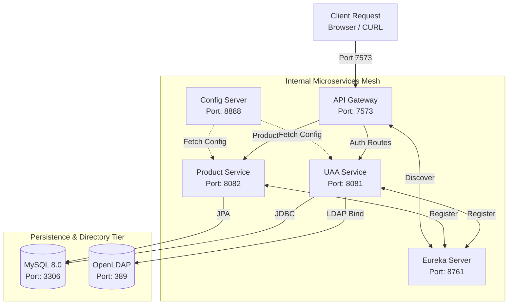
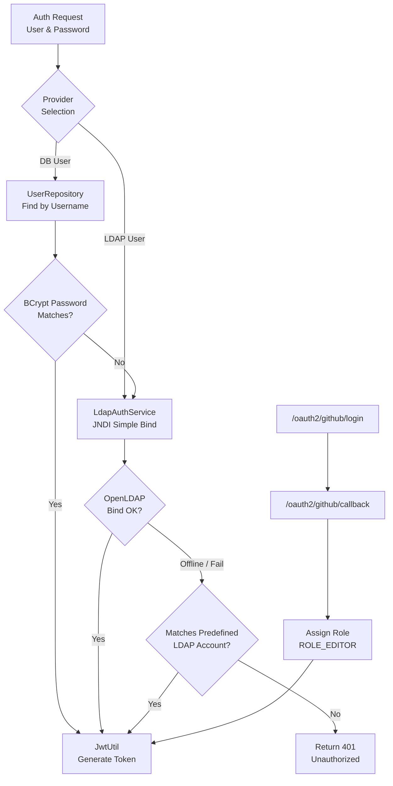

# Technical Architecture and Implementation

This document provides an in-depth architectural and technical specification of the Spring Cloud Microservices Platform.

---

## 1. System Architecture Overview

The system is designed around the **Single Entry Point** and **Stateless Token Authentication** microservices patterns. All external client requests are intercepted by an edge **API Gateway** running on port **`7573` (HTTP)**, which acts as the perimeter guard for the internal service mesh.

### 1.1 Architecture Topology Diagram



---

## 2. Unified Authentication Center (UAA)

The UAA service (`uaa-service`) is responsible for authenticating credentials across three distinct identity providers, managing authorization scopes, and minting cryptographically signed JSON Web Tokens (JWT).

### 2.1 Multi-Provider Authentication Flow

The `/uaa/token` endpoint accepts both `application/x-www-form-urlencoded` and `application/json` payloads. It dispatches credentials to the appropriate authentication provider:



### 2.2 Provider Implementations

#### 1. Database Authentication
- Handled by `UserRepository` backed by Spring Data JPA.
- Passwords are validated using Spring Security's `BCryptPasswordEncoder`.

#### 2. OpenLDAP Authentication
- Implemented in `LdapAuthService` utilizing Java JNDI (`javax.naming.directory.InitialDirContext`).
- Connects to `ldap://ldap:389` and attempts a Simple Bind using user DN `cn={username},ou=users,dc=example,dc=org`.
- **Fault-Tolerance Mechanism**: If the LDAP container is still initializing or unavailable during non-Docker test execution, an embedded fallback verifies pre-configured directory credentials (`ldap_user_1`, `ldap_editor_1`, `ldap_adm_1`).

#### 3. GitHub OAuth2 Authentication
- Implemented in `LoginController` via standard OAuth 2.0 Authorization Code redirection.
- Upon successful authentication callback, the user identity is mapped and granted **`ROLE_EDITOR`** per project specification.

### 2.3 JWT Token Specification
Tokens are minted by `JwtUtil` in the `common` module:
- **Algorithm**: HMAC-SHA256 (`HS256`) signed with a 256-bit symmetric key.
- **Claims Structure**:
  - `sub`: Principal username.
  - `role`: Granted authority (`ROLE_USER`, `ROLE_EDITOR`, or `ROLE_PRODUCT_ADMIN`).
  - `iat`: Epoch timestamp of issuance.
  - `exp`: Epoch timestamp of expiration (24 hours lifetime).

---

## 3. API Gateway & Global Identity Propagation

The gateway (`gateway-service`) is built on **Spring Cloud Gateway** (Project Reactor non-blocking reactive engine).

### 3.1 Single External Port Binding (`7573`)
Only `gateway-service` exposes port `7573` to the host in `docker-compose.yaml`. All other services operate within the private Docker bridge network `microservice-net`.

### 3.2 Global Identity Propagation Filter (`JwtAuthFilter`)
A reactive `GlobalFilter` with priority `Order(-100)` intercepts all incoming requests:
1. Inspects the HTTP header `Authorization: Bearer <token>`.
2. Cryptographically validates token authenticity and expiration using `JwtUtil`.
3. If valid, mutates the downstream request by injecting identity headers:
   - `X-User-Name`: Extracted principal subject.
   - `X-User-Roles`: Extracted role claim.
4. Downstream microservices can either inspect these headers directly or validate the Bearer token locally.

### 3.3 Dynamic Routing Rules
```yaml
spring:
  cloud:
    gateway:
      routes:
        - id: uaa-token-route
          uri: ${UAA_SERVICE_URL:http://localhost:8081}
          predicates:
            - Path=/uaa/**, /token, /login, /api/login, /oauth2/**, /
        - id: product-route
          uri: ${PRODUCT_SERVICE_URL:http://localhost:8082}
          predicates:
            - Path=/products, /products/**
```

---

## 4. Product Service & Hierarchical RBAC

The `product-service` manages product catalog records (`id` auto-increment primary key + `name` product name).

### 4.1 Spring Security 6 Role Hierarchy
The security configuration configures hierarchical role inheritance:
```java
@Bean
public RoleHierarchy roleHierarchy() {
    RoleHierarchyImpl roleHierarchy = new RoleHierarchyImpl();
    roleHierarchy.setHierarchy("ROLE_PRODUCT_ADMIN > ROLE_EDITOR\nROLE_EDITOR > ROLE_USER");
    return roleHierarchy;
}
```

Authority expansion in `JwtAuthenticationFilter`:
- `ROLE_PRODUCT_ADMIN` expands to: `[ROLE_PRODUCT_ADMIN, ROLE_EDITOR, ROLE_USER]`
- `ROLE_EDITOR` expands to: `[ROLE_EDITOR, ROLE_USER]`
- `ROLE_USER` remains: `[ROLE_USER]`

### 4.2 Endpoint Authorization Rules

| Method | Endpoint | Minimum Role Required | Permitted Roles | Unauthorized Response |
| :--- | :--- | :--- | :--- | :--- |
| **GET** | `/products` | `USER` | `USER`, `EDITOR`, `PRODUCT_ADMIN` | `401 Unauthorized` |
| **POST** | `/products` | `EDITOR` | `EDITOR`, `PRODUCT_ADMIN` | `403 Forbidden` |
| **PUT** | `/products/{id}` | `EDITOR` | `EDITOR`, `PRODUCT_ADMIN` | `403 Forbidden` |
| **DELETE** | `/products/{id}` | `EDITOR` | `EDITOR`, `PRODUCT_ADMIN` | `403 Forbidden` |

---

## 5. Dual-Mode Deployment Architecture

To support both containerized evaluation on evaluator servers and lightweight local development, every service utilizes environment variable fallback patterns:

```yaml
spring:
  datasource:
    url: ${SPRING_DATASOURCE_URL:jdbc:h2:mem:microservices_db;DB_CLOSE_DELAY=-1;MODE=MySQL}
eureka:
  client:
    service-url:
      defaultZone: ${EUREKA_SERVER_URL:http://localhost:8761/eureka/}
```

### 5.1 Docker Compose Mode
- Environment variables inject container network hostnames (`mysql:3306`, `discovery:8761`, `ldap:389`).
- MySQL automatically executes `docker/mysql/init.sql` to initialize database schemas and initial user data.
- OpenLDAP mounts and bootstraps directory trees and accounts from `docker/ldap/bootstrap.ldif`.

### 5.2 Local Standalone Mode
- The application automatically defaults to embedded in-memory H2 (MySQL mode) and local ports.
- `DatabaseInitializer` and `ProductInitializer` act as `CommandLineRunner` hooks, populating required test users and initial products on startup without external database dependencies.
- Controlled via `./start-local.sh` and `./stop-local.sh`.
