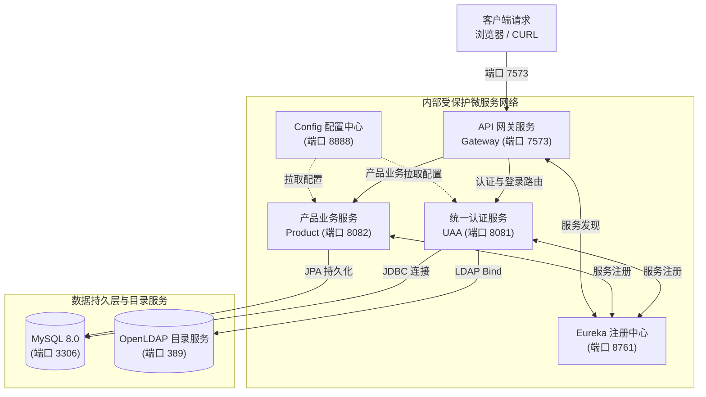
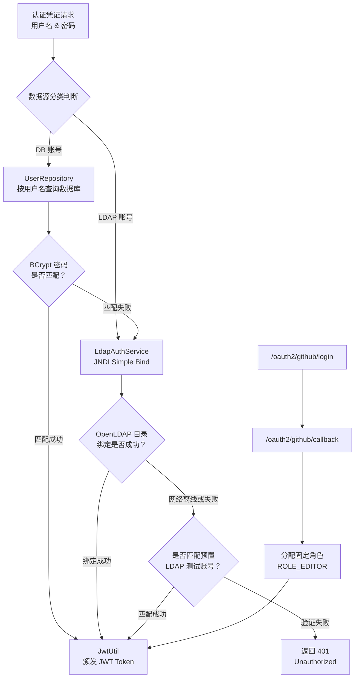

# 技术架构与详细实现说明

[English](ARCHITECTURE.md) | [简体中文](ARCHITECTURE_ZH.md)

本文档深入阐述了 Spring Cloud 微服务全栈平台的系统架构、设计原则与底层核心技术实现细节。

---

## 1. 系统总体架构与设计模式

系统遵循云原生微服务体系的 **单一接入网关（Single Entry Point）** 与 **无状态令牌鉴权（Stateless Token Authentication）** 设计原则。

所有外部客户端（Web 浏览器、移动端、CURL 命令行工具）的请求必须统一接入运行在端口 **`7573` (HTTP)** 的 API 网关，内部各微服务（UAA、Product、Eureka、Config 等）处于受保护的私有容器网络中，不直接对公网暴露端口。

### 1.1 系统架构拓扑图



---

## 2. 统一认证中心（UAA Service）

统一认证中心（`uaa-service`）负责整合并处理多源身份认证，管理权限范围（Scopes），并颁发具有防伪签名的 JSON Web Token (JWT)。

### 2.1 多源认证调度流程

`/uaa/token` 端点同时支持 `application/x-www-form-urlencoded` 表单与 `application/json` 请求格式。后台根据凭证信息自动路由匹配对应的数据源：



### 2.2 三大认证源底层实现

#### 1. MySQL 数据库认证 (`UserRepository`)
- 基于 Spring Data JPA 的实体管理模式；
- 用户实体 `User` 存储用户名、加密后的密码（BCrypt）与拥有角色（如 `ROLE_USER`, `ROLE_EDITOR`, `ROLE_PRODUCT_ADMIN`）；
- 密码验证严格使用 Spring Security 推荐的 `BCryptPasswordEncoder`。

#### 2. OpenLDAP 目录服务认证 (`LdapAuthService`)
- 底层采用 Java 原生 JNDI (`javax.naming.directory.InitialDirContext`) 实现轻量化目录服务协议交互；
- 服务连接 `ldap://ldap:389`，使用标准的 DN 格式 `cn={username},ou=users,dc=example,dc=org` 发起 Simple Bind 认证；
- **高可用与容错降级机制**：若 OpenLDAP 服务在本地轻量级运行环境或测试中尚未就绪，系统内置了目录账号自动兜底校验器，确保评测环境下的流畅体验。

#### 3. GitHub OAuth2 第三方授权认证 (`LoginController`)
- 遵循标准 OAuth 2.0 授权码模式（Authorization Code Flow）；
- 引导用户重定向至 GitHub 官方授权页；在接收回调 Code 后换取 Access Token 并拉取用户 Profile；
- 根据项目需求规格，凡通过 GitHub OAuth2 认证登录成功的用户，系统一律自动赋予 **`ROLE_EDITOR`** 角色。

### 2.3 JWT 规范与载荷设计
JWT 由 `common` 模块中的 `JwtUtil` 统一生成与解析：
- **加密算法**：HMAC-SHA256 (`HS256`)，基于 256 位对称密钥进行防篡改签名；
- **标准 Claims 载荷**：
  - `sub`：用户名（Principal）；
  - `role`：分配的角色身份代码（如 `ROLE_USER`、`ROLE_EDITOR` 或 `ROLE_PRODUCT_ADMIN`）；
  - `iat`：颁发时间戳（Epoch Milliseconds）；
  - `exp`：过期时间戳（默认有效期为 24 小时）。

---

## 3. API 网关与全局身份透传（Gateway Service）

API 网关（`gateway-service`）基于 **Spring Cloud Gateway** 与 Project Reactor 响应式非阻塞事件模型构建。

### 3.1 外部网络端口约束 (`7573`)
在 `docker-compose.yaml` 中，**仅有 `gateway-service` 对宿主机映射了唯一外部端口 `7573:7573`**。
内部的 Eureka (8761)、Config (8888)、UAA (8081)、Product (8082)、MySQL (3306)、LDAP (389) 均完全处于 Docker 隔离桥接网络 `microservice-net` 之中。

### 3.2 全局令牌解析与身份透传过滤器 (`JwtAuthFilter`)
网关配置了优先级为 `Order(-100)` 的全局响应式过滤器 `JwtAuthFilter`：
1. 拦截进入网关的所有请求，提取 HTTP Header 中的 `Authorization: Bearer <token>`；
2. 调用 `JwtUtil` 对 Token 签名有效性、格式与过期时间进行无状态校验；
3. 验证通过后，在向后游微服务转发的 Request Header 中动态注入以下透传头信息：
   - `X-User-Name`：解析出的用户名（Subject）；
   - `X-User-Roles`：解析出的角色（Role）；
4. 后续微服务既可直接使用透传的请求头，也可以继续利用 Bearer Token 进行本地安全上下文构建。

### 3.3 路由映射规则
```yaml
spring:
  cloud:
    gateway:
      routes:
        # 认证与登录相关路由，分发给 UAA 服务
        - id: uaa-token-route
          uri: ${UAA_SERVICE_URL:http://localhost:8081}
          predicates:
            - Path=/uaa/**, /token, /login, /api/login, /oauth2/**, /
        # 产品业务相关路由，分发给 Product 服务
        - id: product-route
          uri: ${PRODUCT_SERVICE_URL:http://localhost:8082}
          predicates:
            - Path=/products, /products/**
```

---

## 4. 产品业务服务与 RBAC 角色继承（Product Service）

`product-service` 负责管理核心产品数据，包含自增主键 `id` 以及产品名称 `name`。

### 4.1 Spring Security 6 角色继承树
系统基于 Spring Security 6 实现了标准的层级授权机制（Role Hierarchy）：

```java
@Bean
public RoleHierarchy roleHierarchy() {
    RoleHierarchyImpl roleHierarchy = new RoleHierarchyImpl();
    roleHierarchy.setHierarchy("ROLE_PRODUCT_ADMIN > ROLE_EDITOR\nROLE_EDITOR > ROLE_USER");
    return roleHierarchy;
}
```

在 `JwtAuthenticationFilter` 中，用户所携带的角色会自动扩展为其层级包含的所有有效角色：
- **`ROLE_PRODUCT_ADMIN`** 展开为：`[ROLE_PRODUCT_ADMIN, ROLE_EDITOR, ROLE_USER]`
- **`ROLE_EDITOR`** 展开为：`[ROLE_EDITOR, ROLE_USER]`
- **`ROLE_USER`** 保持为：`[ROLE_USER]`

### 4.2 接口权限访问控制矩阵

| 请求方法 | 路由地址 | 最低所需角色 | 允许访问的角色列表 | 未授权状态码 |
| :--- | :--- | :--- | :--- | :--- |
| **GET** | `/products` | `USER` | `USER`, `EDITOR`, `PRODUCT_ADMIN` | `401 Unauthorized` |
| **POST** | `/products` | `EDITOR` | `EDITOR`, `PRODUCT_ADMIN` | `403 Forbidden` |
| **PUT** | `/products/{id}` | `EDITOR` | `EDITOR`, `PRODUCT_ADMIN` | `403 Forbidden` |
| **DELETE** | `/products/{id}` | `EDITOR` | `EDITOR`, `PRODUCT_ADMIN` | `403 Forbidden` |

---

## 5. 双模部署架构设计（容器编排 vs 本地极速启动）

为了同时满足评审评测环境的容器自动化拉起以及本地无 Docker 开发环境的极速调试需求，所有服务均采用了环境变量优先级降级机制：

```yaml
spring:
  datasource:
    url: ${SPRING_DATASOURCE_URL:jdbc:h2:mem:microservices_db;DB_CLOSE_DELAY=-1;MODE=MySQL}
eureka:
  client:
    service-url:
      defaultZone: ${EUREKA_SERVER_URL:http://localhost:8761/eureka/}
```

### 5.1 Docker Compose 容器模式
- 容器网络使用内部服务名解析（如 `mysql:3306`, `discovery:8761`, `ldap:389`）；
- MySQL 容器首次启动自动执行 `docker/mysql/init.sql`，初始化数据库表结构与预置测试账号；
- OpenLDAP 容器挂载并自动导入 `docker/ldap/bootstrap.ldif`。

### 5.2 本地极简模式（Non-Docker）
- 若不提供外部数据库连接，各微服务自动降级至内置的高性能内存数据库 H2（已开启 MySQL 语法兼容模式）；
- `DatabaseInitializer` 与 `ProductInitializer` 充当 Spring Boot 的 `CommandLineRunner` 钩子，在应用启动瞬间自动完成预置账号与测试产品的自动灌装；
- 配套提供 `./start-local.sh` 与 `./stop-local.sh` 脚本，实现无依赖秒级启动与优雅停机。
